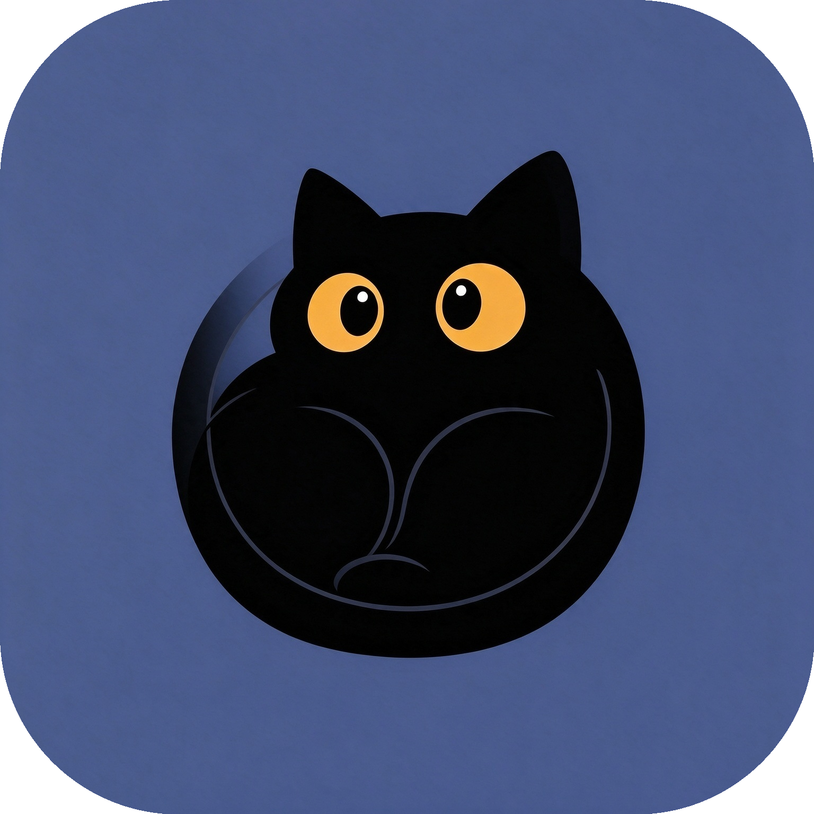

# Catlas (猫图集) - A Native Desktop OpenStreetMap (OSM) Mapping Tool for Windows

<div align="center">



# Catlas（猫图集）

**OSM 地理数据自动抓取与制图工具**

输入任意地名或坐标范围，自动从 OpenStreetMap 抓取**路网、水域、绿地、建筑**数据，
清洗后导出 GeoJSON / GeoPackage / Shapefile，并渲染为 SVG / PNG 地图。

[](https://github.com/Wing-Smith/Catlas/releases)
[](https://github.com/Wing-Smith/Catlas/releases)
[](https://www.openstreetmap.org/copyright)

[下载](https://github.com/Wing-Smith/Catlas/releases/latest) · [更新日志](https://github.com/Wing-Smith/Catlas/releases) · [从源码构建](#打包)

</div>

> **📌 Note about the name:**
> 
> 如果你们在寻找那个渲染 Minecraft 地图的 Rust 工具，请去搜小写的 `catlas`；如果你们在寻找那个 C++ 空间索引引擎，请**出门左转去 CSDN**。
> 
> 这里是 **Catlas (猫图集)**，一个用 Python + PySide6 打造的原生桌面级 OSM 数据抓取与矢量制图工具。因为我们的黑猫（Calico）太可爱了，所以这个名字**必须大写**！🐈‍⬛

- GUI：PySide6 + PySide6-Fluent-Widgets，Windows 11 Mica 毛玻璃
- 数据：Overpass API 多镜像探测 + 过载退避重试 + 网格分块 + 本地 parquet 缓存
- 纯 Python 3.14（Windows），core 层零 GUI 依赖

## 下载

**[最新版 v1.3.2 已发布 → Releases 页面](https://github.com/Wing-Smith/Catlas/releases/latest)**

下载 `Catlas-Setup-1.3.2.exe` 双击安装即可（Windows 10 1809+，64 位）。
应用内置自动更新检测，新版本发布后会自动提醒。

> 地图数据 © OpenStreetMap contributors（ODbL）；Esri World Imagery 卫星底图仅限软件内在线预览，禁止导出。

## 安装

```bash
py -3.14 -m venv .venv
.venv\Scripts\python.exe -m pip install -i https://pypi.org/simple -r requirements.txt
```

> 国内网络装 GUI 包慢时，PySide6 相关包可改用阿里云镜像：
> `.venv\Scripts\python.exe -m pip install -i https://mirrors.aliyun.com/pypi/simple/ PySide6-Essentials PySideSix-Frameless-Window PySide6-Fluent-Widgets darkdetect pywin32`

## 使用

GUI：

```bash
.venv\Scripts\python.exe -m app.main
```

CLI（同一份 core 管线）：

```bash
# 地名 → 抓取 → 导出 GeoJSON + PNG
.venv\Scripts\python.exe -m app.cli "北京故宫" --formats geojson png --out out/gugong

# 坐标范围 → 全格式导出
.venv\Scripts\python.exe -m app.cli --bbox 39.905 116.395 39.910 116.400 \
    --formats geojson gpkg shp svg png --out out/test

# 指定图层 / 叠加瓦片底图（osm_de / osm_official / hot / osmfr / seamark / esri）
.venv\Scripts\python.exe -m app.cli "上海 外滩" --layers road building --formats svg --basemap osm_de
.venv\Scripts\python.exe -m app.cli --clear-cache
```

打包（需先装好全部依赖）：

```powershell
# Nuitka standalone 编译（MVSC，jobs 按机器调整）
powershell -NoProfile -ExecutionPolicy Bypass -File scripts\build_nuitka.ps1
# Inno Setup 安装包（需先安装 Inno Setup 7）
# 用 Inno 打开 installer\catlas.iss 编译，产物 Release\installer\Catlas-Setup-x.y.z.exe
```

在程序目录或 exe 旁放置 `portable.flag` 可启用便携模式（数据写入 `CatlasData/`，不写注册表目录）。

## 架构

```
app/
├─ core/        # 领域层（无 GUI 依赖）：geocode / fetch / clean / export / cache / pipeline
├─ services/    # 应用层：QThread 后台任务封装
├─ ui/          # 表现层：main_window / input_panel / map_canvas / theme(Mica)
├─ cli.py       # CLI 入口
└─ main.py      # GUI 入口
```

- 地理编码：Nominatim 优先、Photon 兜底，供应商熔断
- 抓取：镜像健康探测（剔除空库镜像）、429/504 指数退避、>5 km² 自动网格分块（上限 64 块）
- 缓存：bbox+图层 SHA1 键控 parquet + 瓦片磁盘缓存，LRU 容量清理
- 底图：免 Key 瓦片源（标准/官方/HOT/OSM France/海图标注/Esri 卫星影像），
  预览与 PNG/SVG 制图叠加，Web Mercator 对齐矢量图层
- 渲染：UTM/Web Mercator 投影保证比例，图例中文自动适配

## 测试

```bash
.venv\Scripts\python.exe -m pytest tests/ -q
```

## ❓ FAQ (Frequently Asked Questions)

<details>
<summary><b>1. 关于名字 "Catlas" 的撞名问题 / Name Collisions</b></summary>

**Q: 我在网上搜到了好几个 Catlas，你们是同一个吗？ / I found several "Catlas" projects online. Are they the same?**
**A:** 绝对不是。 / Absolutely not.
*   如果你在找那个渲染 Minecraft 游戏地图的 Rust 工具，请去搜小写的 `catlas`。 / If you are looking for the Rust tool that renders Minecraft maps, please search for lowercase `catlas`.
*   如果你在找那个传说中的 C++ 空间索引引擎，请**出门左转去 CSDN**（那大概率是一篇 AI 生成的赛博水文）。 / If you are looking for the legendary C++ spatial indexing engine, please **turn left to CSDN** (which is highly likely an AI-generated hallucination).
*   这里是 **Catlas (猫图集)**，一个纯粹的、用 Python + PySide6 打造的原生 Windows 桌面级 OSM 抓取与制图工具。因为我们的黑猫（Calico）太可爱了，所以这个名字必须大写！🐈‍⬛ / This is **Catlas**, a pure, native Windows desktop OSM fetching and mapping tool built with Python + PySide6. Because our black cat (Calico) is too cute, this name **must be capitalized**!
</details>

<details>
<summary><b>2. 技术与架构 / Tech & Architecture</b></summary>

**Q: 为什么不用 WebViewer 套壳？或者为什么不用 Electron？ / Why not use a WebViewer wrapper or Electron?**
**A:** 我们坚决拒绝为了跨平台而牺牲性能和原生体验。Catlas 采用纯正的 PySide6 渲染，利用底层 C 语言机器码（通过 Nuitka 编译），启动速度极快、内存占用极低。它长得就像 Windows 11 的原生应用（Fusion 样式 + Mica 毛玻璃），绝不往你的电脑里塞一个 Chromium 浏览器内核。 / We firmly refuse to sacrifice performance and native experience for cross-platform compatibility. Catlas uses pure PySide6 rendering and leverages low-level C machine code (compiled via Nuitka), resulting in blazing-fast startup and low memory usage. It looks exactly like a native Windows 11 app (Fusion style + Mica material) and absolutely will not stuff a Chromium engine into your computer.

**Q: 我拔掉网线后还能用吗？ / Can I use it offline?**
**A:** 可以。只要你不抓取新数据，你之前抓取并缓存到本地的数据（Parquet 格式）完全可以离线查看和导出。软件本身的更新检测和底图预览需要网络。 / Yes. As long as you don't fetch new data, the previously fetched and locally cached data (in Parquet format) can be viewed and exported completely offline. Network is only required for update checks and basemap previews.
</details>

<details>
<summary><b>3. 平台与生态 / Platforms & Ecosystem</b></summary>

**Q: 会出 macOS 或 iOS 版本吗？ / Will there be a macOS or iOS version?**
**A:** **永远不会。** 我们信仰开放的互联网与开源生态，拒绝向苹果封闭的“围墙花园”妥协，也拒绝支付每年 99 美元的开发者保护费。请使用 Windows、Linux 或 Android。 / **Never.** We believe in an open internet and open-source ecosystem. We refuse to compromise with Apple's closed "walled garden" and refuse to pay the $99/year developer fee. Please use Windows, Linux, or Android.

**Q: 会有 Linux 和 Android 版本吗？ / Will there be Linux and Android versions?**
**A:** 
*   **Linux 版**：正在由我们的首席 Linux 架构师（`libfsx.so`）爆肝开发中，敬请期待。 / **Linux:** Currently under heavy development by our Chief Linux Architect (`libfsx.so`). Stay tuned.
*   **Android 版**：已列入 2027 年路线图，将由原生的 Kotlin/Compose 完全重写，拒绝粗劣的 UI 拉伸。 / **Android:** Scheduled for 2027. It will be completely rewritten using native Kotlin/Compose, rejecting poor UI stretching.
*   **Web (WebViewer) 版**：2030 年再说吧。 / **Web (WebViewer):** Let's talk about it in 2030.
</details>

<details>
<summary><b>4. 报错与故障排查 / Troubleshooting</b></summary>

**Q: 为什么双击 `Catlas.exe` 提示缺少 `VCRUNTIME140.dll` 或 `python314.dll`？ / Why does it say missing `VCRUNTIME140.dll` or `python314.dll` when I run it?**
**A:** 恭喜你，这证明你下载的是纯正的**原生 C 语言编译产物**（Nuitka 的杰作）。请确保你使用的是 **安装包（`Catlas-Setup-x.x.x.exe`）** 进行安装，而不是把 exe 单独拖出来。安装包会自动处理底层依赖。如果仍缺失，请安装微软官方的 [Visual C++ Redistributable](https://aka.ms/vs/17/release/vc_redist.x64.exe)。 / Congratulations, this proves you are running a pure **native C-compiled binary** (Nuitka's masterpiece). Please make sure you are using the **Installer (`Catlas-Setup-x.x.x.exe`)** instead of dragging the exe out alone. The installer handles low-level dependencies automatically. If it's still missing, please install Microsoft's official [Visual C++ Redistributable](https://aka.ms/vs/17/release/vc_redist.x64.exe).

**Q: 为什么我的 Windows Defender 报毒了？ / Why did Windows Defender flag it as a virus?**
**A:** 因为 Nuitka 编译出来的机器码权限极高，部分敏感的杀毒软件可能会误报。你可以前往我们的 [GitHub Actions] 查看开源构建日志，或在本地使用 Nuitka 源码自行编译。 / Because the machine code compiled by Nuitka has high privileges, some sensitive antivirus software may give a false positive. You can check our [GitHub Actions]for open-source build logs, or compile the source code locally using Nuitka.
</details>

<details>
<summary><b>5. 数据与版权 / Data & Copyright</b></summary>

**Q: 导出的地图数据我可以商用吗？ / Can I use the exported map data commercially?**
**A:** 地图数据来源于 OpenStreetMap，遵循 **ODbL 协议**。你可以免费使用，但必须保留版权声明。另外，Esri 的高清卫星底图仅限在软件内预览，**严禁导出**用于任何商业项目。 / Map data is sourced from OpenStreetMap and follows the **ODbL license**. You can use it for free, but you must retain the copyright notice. Additionally, Esri's high-res satellite basemap is strictly for in-app preview only and **must not be exported** for any commercial projects.
</details>

---
*Last updated: 2026-11*
